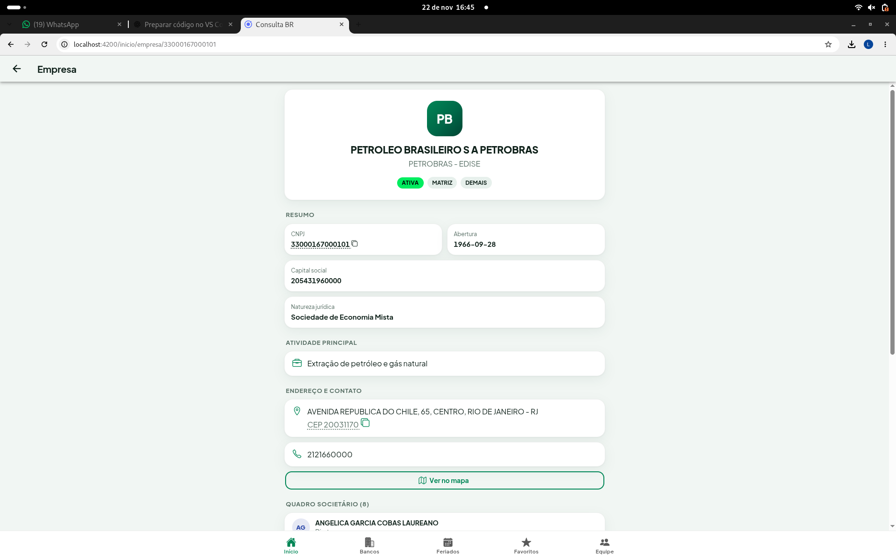
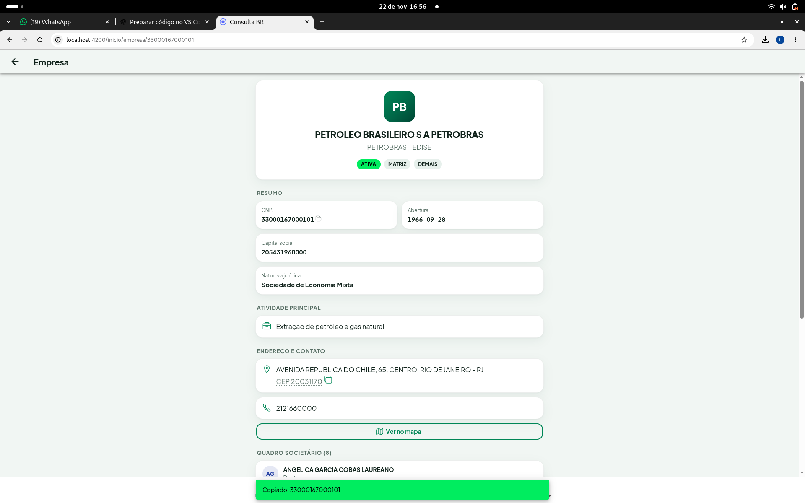
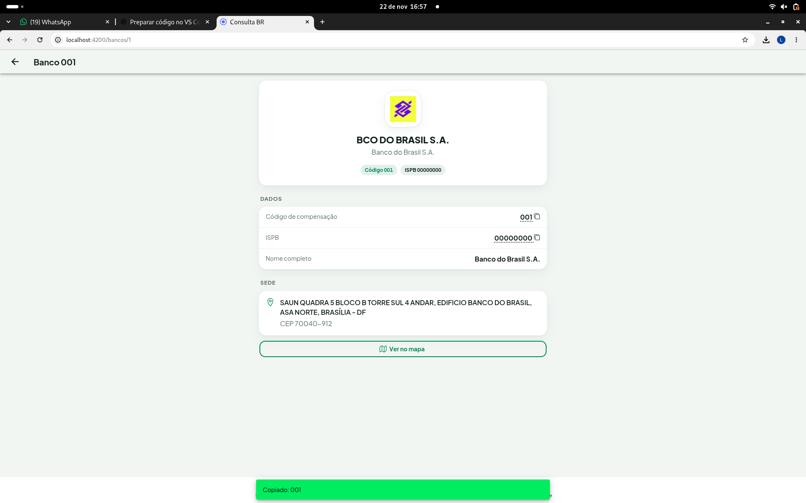

# Consulta BR

## Sobre o projeto

O Consulta BR é um aplicativo desenvolvido com Angular e Ionic que permite consultar informações públicas do Brasil de forma simples e organizada.

O aplicativo reúne funcionalidades para consulta de empresas por CNPJ, endereços por CEP, instituições bancárias e feriados nacionais.

Os dados são obtidos por meio da BrasilAPI.

## Tecnologias utilizadas

- Angular
- Ionic Framework
- TypeScript
- HTML e SCSS
- BrasilAPI
- Git e GitHub

## Como executar o projeto

### Pré-requisitos

- Node.js
- npm

### Instalação

No terminal, dentro da pasta do projeto, execute:

```bash
npm install
```

### Executar a aplicação

```bash
npm start
```

A aplicação poderá ser acessada em `http://localhost:4200`.

### Outros comandos

```bash
npm run lint       # ESLint, tipos do e2e e Prettier
npm run test:unit  # testes unitários (Vitest)
npm run build      # build de produção
```

## Funcionalidades

- Consulta de empresas por CNPJ.
- Consulta de endereços por CEP.
- Listagem e consulta de instituições bancárias.
- Consulta de feriados nacionais.
- Gerenciamento de favoritos.
- Identificação visual da situação cadastral das empresas.
- Cópia de informações como CNPJ, CEP, código bancário e ISPB.


## Diretivas Angular desenvolvidas

O projeto utiliza duas diretivas Angular reutilizáveis para melhorar a experiência do usuário: `SituacaoDirective` e `CopiarDirective`.

### SituacaoDirective — Situação cadastral

**Arquivo:** `src/app/shared/directives/situacao.directive.ts`

A diretiva `SituacaoDirective` identifica a situação cadastral de uma empresa e altera automaticamente a cor do indicador visual.

As cores utilizadas são:

- **ATIVA:** verde (`success`).
- **SUSPENSA:** amarelo (`warning`).
- **BAIXADA, INAPTA ou NULA:** vermelho (`danger`).
- **Outras situações:** cinza (`medium`).

A diretiva utiliza `@Input` para receber a situação cadastral e `@HostBinding` para definir a cor e a descrição exibida ao usuário.

**Onde aparece:** na página de detalhes de uma empresa.

**Exemplo de utilização:**

```html
<ion-badge [appSituacao]="e.descricao_situacao_cadastral">
  {{ e.descricao_situacao_cadastral }}
</ion-badge>
```

### CopiarDirective — Copiar informações

**Arquivo:** `src/app/shared/directives/copiar.directive.ts`

A diretiva `CopiarDirective` permite copiar informações para a área de transferência ao clicar sobre um elemento da página.

Ela utiliza:

- `@Input` para receber o texto que será copiado.
- `@HostListener` para identificar o clique do usuário.
- `@HostBinding` para aplicar características visuais ao elemento.
- `navigator.clipboard.writeText()` para copiar o conteúdo.
- `ToastController` do Ionic para mostrar uma mensagem de confirmação.

Quando a cópia funciona, o aplicativo exibe uma mensagem verde informando o conteúdo copiado. Caso ocorra um erro, apresenta uma mensagem de falha.

**Onde aparece:**

- Detalhes das empresas: cópia de CNPJ e CEP.
- Detalhes dos bancos: cópia do código de compensação e ISPB.

**Exemplo de utilização:**

```html
<strong [appCopiar]="e.cnpj" title="Clique para copiar o CNPJ">
  {{ e.cnpj | cnpj }}
</strong>
```

### Benefícios das diretivas

As diretivas permitem reutilizar comportamentos em diferentes telas, evitando repetição de código e facilitando a manutenção do aplicativo.


## Integração com a BrasilAPI

O aplicativo Consulta BR utiliza a BrasilAPI para obter informações públicas de empresas, endereços, instituições bancárias e feriados nacionais.

As requisições HTTP são centralizadas no serviço:

`src/app/core/services/brasil-api.service.ts`

Esse serviço utiliza o `HttpClient` do Angular para realizar consultas à API e disponibilizar os resultados para as páginas do aplicativo.

### Endpoints utilizados

| Método | Endpoint | Finalidade |
|---|---|---|
| GET | `/banks/v1` | Consultar a lista de bancos |
| GET | `/banks/v1/{codigo}` | Consultar um banco pelo código |
| GET | `/cnpj/v1/{cnpj}` | Consultar informações de uma empresa |
| GET | `/cep/v2/{cep}` | Consultar um endereço pelo CEP |
| GET | `/feriados/v1/{ano}` | Consultar os feriados nacionais de um ano |

**Documentação oficial:** https://brasilapi.com.br/

### Tratamento das requisições

O serviço implementa recursos para melhorar a organização e a confiabilidade das consultas:

- **Tempo limite:** cada requisição possui um limite de espera de 15 segundos.
- **Normalização:** CNPJ e CEP são enviados à API contendo apenas números.
- **Cache:** a listagem de bancos utiliza `shareReplay(1)` para reaproveitar a resposta.
- **Filtragem:** a listagem de bancos remove registros sem código válido e organiza os resultados por código.
- **Centralização:** as páginas utilizam o `BrasilApiService`, evitando chamadas HTTP diretamente nos componentes.

### Exemplos de utilização

**Consultar uma empresa:**

```typescript
this.api.getEmpresa('33000167000101');
```

**Consultar um banco:**

```typescript
this.api.getBanco(1);
```

**Consultar um CEP:**

```typescript
this.api.getCep('20031170');
```

Esses exemplos demonstram chamadas aos métodos disponíveis no serviço.


## Equipe e responsabilidades

O projeto Consulta BR foi desenvolvido em equipe, com divisão de responsabilidades entre os integrantes.

| Integrante | Responsabilidade |
|---|---|
| Lucas Cardoso | Desenvolvimento das diretivas Angular e documentação do projeto |
| Gabriel Fernando | Implementação de pipes personalizadas e utilização de pipes nativas do Angular |
| Guilherme Juarez | Desenvolvimento do serviço de favoritos e da tela de favoritos |
| Guilherme Aguiar | Desenvolvimento da tela de feriados utilizando `@if` e `@for` |
| Arthur Niceas | Arquitetura, telas e integração com a API |

As funcionalidades foram desenvolvidas em branches separadas e encaminhadas para revisão por meio de Pull Requests no GitHub.

## Mapeamento dos requisitos

A tabela abaixo apresenta os principais requisitos do projeto, os arquivos relacionados e as telas em que podem ser demonstrados.

| Requisito | Arquivo principal | Tela |
|---|---|---|
| Consulta de empresas por CNPJ | `core/services/brasil-api.service.ts` | Início e detalhes da empresa |
| Consulta de CEP | `core/services/brasil-api.service.ts` | Início |
| Consulta de bancos | `core/services/brasil-api.service.ts` | Bancos e detalhes do banco |
| Consulta de feriados | `pages/feriados/feriados.page.ts` | Feriados |
| Serviço de favoritos | `core/services/favoritos.service.ts` | Favoritos |
| Pipe personalizada de CNPJ | `shared/pipes/cnpj.pipe.ts` | Detalhes da empresa |
| Pipe personalizada de CEP | `shared/pipes/cep.pipe.ts` | Início, detalhes da empresa e do banco |
| Pipe personalizada de telefone | `shared/pipes/telefone.pipe.ts` | Detalhes da empresa |
| Pipes nativas do Angular | `pages/empresa-detalhe/empresa-detalhe.page.ts` | Detalhes da empresa |
| Diretiva de situação cadastral | `shared/directives/situacao.directive.ts` | Detalhes da empresa |
| Diretiva de copiar informações | `shared/directives/copiar.directive.ts` | Detalhes da empresa e do banco |
| Estruturas `@if` e `@for` | `pages/feriados/feriados.page.html` | Feriados |


## Capturas de tela

As imagens abaixo demonstram o funcionamento das diretivas Angular desenvolvidas no projeto.

### Situação cadastral da empresa

A diretiva `SituacaoDirective` identifica a situação cadastral e apresenta um indicador visual com a cor correspondente.



### Cópia do CNPJ

A diretiva `CopiarDirective` permite copiar o CNPJ da empresa e exibe uma mensagem de confirmação.



### Cópia do código bancário

A mesma diretiva também permite copiar o código de compensação de um banco.


